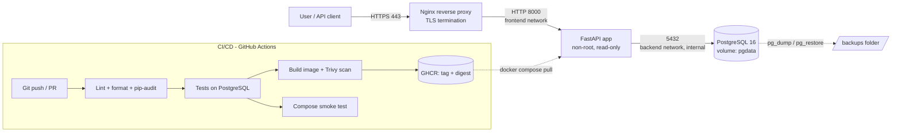
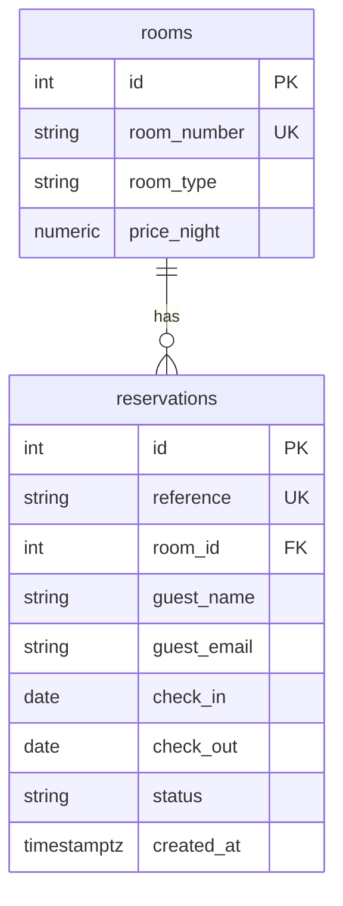

# Architecture



## Components

| Component | Responsibility | Exposure |
|---|---|---|
| Nginx | TLS, HTTP→HTTPS redirect, security headers, reverse proxy | Ports 80, 443 |
| FastAPI | Availability + reservation API, `/health`, `/ready`, JSON logs | Internal 8000 |
| PostgreSQL | Rooms + reservations, exclusion constraint prevents overlaps | Internal only |
| GitHub Actions | Verify, build, scan, publish versioned image | – |

## Data model



**Overlap rule** (in `app/schema.sql`):

```sql
EXCLUDE USING gist (room_id WITH =, daterange(check_in, check_out, '[)') WITH &&)
WHERE (status = 'confirmed')
```

Why in the database and not in application code: a "check then insert" in Python has a race window
between the two steps. The constraint is enforced atomically by PostgreSQL, so two concurrent
requests can never both commit. The app catches the violation and tries the next free room, or
returns `409 Conflict` when none is left.
